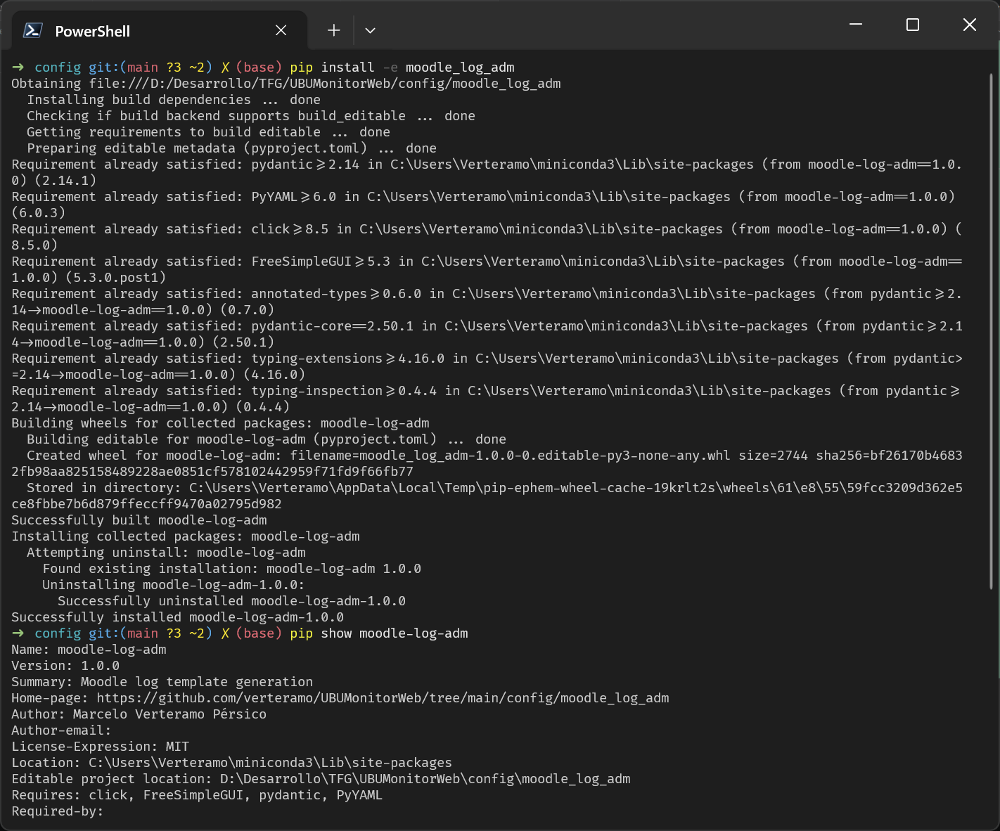
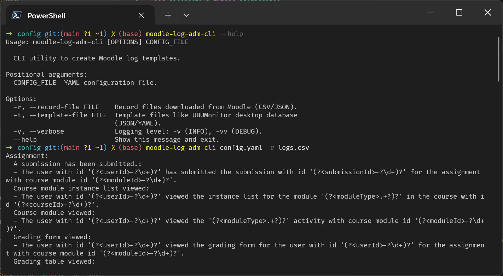
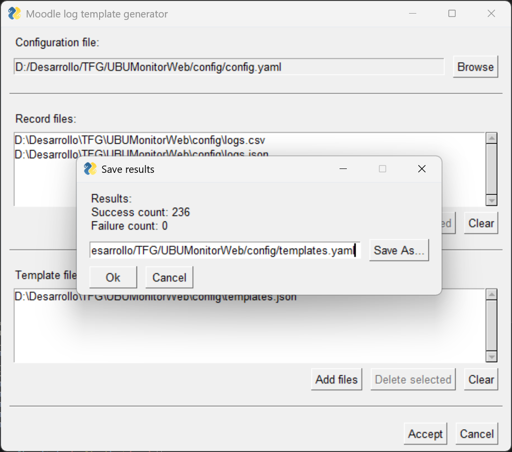

# Instalación de `moodle-log-adm`

Pasos para instalar, utilizando `pip`, el paquete `moodle-log-adm` directamente desde su subdirectorio en el repositorio de UBUMonitorWeb.

## Requisitos previos

Es recomendable instalar el paquete dentro de un entorno virtual para no interferir con las dependencias globales del sistema.

## Paso 1: Crear y activar el entorno virtual

Se puede usar Conda o el gestor de entornos de preferencia. Es importante usar una versión de Python >= 3.12.

```bash
# Creación del entorno aislando una versión específica de Python
conda create -n moodle-log-adm-testing python=3.12 -y

# Activación el entorno
conda activate moodle-log-adm-testing
```

## Paso 2: Instalación desde el repositorio

Dado que `moodle-log-adm` no se encuentra en la raíz del repositorio, sino en un subdirectorio, se utiliza una URL de Git que le indique a `pip` exactamente dónde buscar el fichero `pyproject.toml`:

```bash
pip install "git+https://github.com/verteramo/UBUMonitorWeb.git@main#subdirectory=config/moodle_log_adm"
```

## Paso 3: Verificación de la instalación

Si el proceso se ejecuta correctamente, `pip` clonará el repositorio, resolverá las dependencias (como `pydantic`, `PyYAML`, `click` y `FreeSimpleGUI`), compilará el paquete y lo instalará en el entorno activo.

Para verificar que el paquete está correctamente instalado y accesible:
```bash
pip show moodle-log-adm
```

Captura de pantalla en la que solo cambia que el paquete es instalado localmente usando el nombre del directorio y no la URL del repositorio:


---

# Uso de la CLI

Uso de la interfaz de línea de comandos (`moodle-log-adm-cli`) para la inferencia y generación automática de plantillas de expresiones regulares a partir de registros de Moodle.



## Visión general y ayuda del sistema

Ver la ayuda:
```bash
moodle-log-adm-cli --help
```

La salida mostrará la estructura de argumentos obligatorios y opcionales permitidos:
```text
Usage: moodle-log-adm-cli [OPTIONS] CONFIG_FILE

  CLI utility to create Moodle log templates.

Positional arguments:
  CONFIG_FILE  YAML configuration file.

Options:
  -r, --record-file FILE    Record files downloaded from Moodle (CSV/JSON).
  -t, --template-file FILE  Template files like UBUMonitor desktop database
                            (JSON/YAML).
  -v, --verbose             Logging level: -v (INFO), -vv (DEBUG).
  --help                    Show this message and exit.
```

## Ejecución básica del procesamiento de logs

La herramienta procesa las fuentes de entrada evaluando las reglas definidas en el fichero de configuración y devuelve por la salida estándar (`stdout`) el resultado estructurado en formato YAML, agrupado por componentes y eventos.

Ejemplo utilizando el fichero de configuración y un archivo CSV de registros:

```bash
moodle-log-adm-cli config.yaml -r logs.csv
```

Como resultado, la consola imprimirá el árbol de plantillas identificadas de forma limpia:

```yaml
Assignment:
  A submission has been submitted.:
    - The user with id '(?<userId>-?\d+)?' has submitted the submission with id '(?<submissionId>-?\d+)?' for the assignment with course module id '(?<moduleId>-?\d+)?'.
  Course module instance list viewed:
    - The user with id '(?<userId>-?\d+)?' viewed the instance list for the module '(?<moduleType>.+?)' in the course with id '(?<courseId>-?\d+)?'.
```

## Redirección de flujos a ficheros físicos (`1>` y `2>`)

Durante la ejecución de la CLI, el sistema genera dos tipos de flujos de salida independientes que es muy útil separar para la auditoría y persistencia de resultados:

1. **Salida estándar (`stdout` / descriptor `1`):** Contiene el resultado estructurado de los templates generados con éxito.
2. **Salida de errores y avisos (`stderr` / descriptor `2`):** Contiene los logs de los cuales no se ha podido inferir ningún campo. Hay que tener en cuenta que si se usa la opción `--verbose`, su salida se producirá en este flujo, por lo que si solo se desean capturar los logs, conviene no habilitar el logging con `-v` o `-vv`.

Mediante los operadores de redirección de la shell, se pueden persistir estos flujos directamente en ficheros físicos:

```bash
moodle-log-adm-cli config.yaml -r logs.csv -v 1> templates_success.yaml 2> templates_failure.yaml
```

---

# Uso de la GUI

La herramienta cuenta con una interfaz gráfica de usuario (`moodle-log-adm-gui`) construida sobre FreeSimpleGUI, diseñada para facilitar la configuración de parámetros y la ejecución visual del motor de inferencia sin necesidad de recurrir a la consola.



## Componentes principales de la interfaz

La ventana principal se divide en tres secciones de entrada bien diferenciadas:

* **Configuration file:** Permite seleccionar el archivo de configuración YAML principal (mediante el botón **Browse**) que define las reglas de inferencia (*rules*), los tipos de datos (*keywords*) y las reglas de formateo (*formatter*).
* **Record files:** Bloque para gestionar la lista de ficheros de registros en formato CSV o JSON (descargados de Moodle). Incluye botones para **Add files** (añadir), **Delete selected** (eliminar selección) y **Clear** (limpiar lista).
* **Template file:** Bloque para gestionar la lista de ficheros de plantillas de eventos anonimizados (como estructuras JSON/YAML existentes) para enriquecer el proceso de inferencia.

En la parte inferior se encuentran los botones de control global: **Accept** (para iniciar el procesamiento de los ficheros seleccionados) y **Cancel** (para salir de la aplicación).

## Ejecución y diálogo de guardado de resultados

Una vez configuradas las rutas de los archivos de entrada y pulsado el botón **Accept**, el motor procesa masivamente los registros y muestra de forma inmediata una ventana emergente de resumen titulada **Save results**.

Este cuadro de diálogo muestra métricas clave del proceso de inferencia:
* **Success count:** Número total de registros o templates procesados e inferidos con éxito.
* **Failure count:** Número de registros que no coincidieron con ninguna regla y no pudieron ser inferidos.

Finalmente, la ventana ofrece un campo de ruta editable y un botón **Save As...** para seleccionar la ubicación física y guardar de forma persistente el archivo YAML con el resultado consolidado de las plantillas generadas, cerrando el proceso al pulsar **Ok**.

---

# Fichero de configuración YAML

El motor de inferencia de `moodle-log-adm` se configura completamente mediante un fichero YAML estructurado en tres bloques principales: `formatter`, `keywords` y `rules`.

### Estructura del fichero de configuración

* **`formatter`**: Define cómo se construirán los grupos de captura en las expresiones regulares finales. Permite configurar la sintaxis nativa según el motor de destino (por ejemplo, Java, PCRE, Python, .NET), establecer reglas de sanitización de caracteres especiales mediante expresiones regulares y definir listas de alias para mapear nombres de grupos de captura alternativos.
* **`keywords`**: Declara los tipos de datos reconocibles por el motor (como `int`, `str` o `any`). Cada keyword especifica su patrón regex base, los envoltorios permitidos (`wrappers` como comillas simples, dobles o sin envoltorio) y comodines o alternativas de texto (`placeholders`).
* **`rules`**: Contiene la lista de pseudo-expresiones regulares utilizadas para escanear las descripciones de los logs. Utilizan la notación de etiquetas `{campo:keyword}` para identificar y extraer dinámicamente los valores.

---

### Ejemplo completo de configuración (`config.yaml`)

```yaml
################################################################################
# Configuración del Motor de Inferencia (Moodle Log Admin)
# ------------------------------------------------------------------------------
# Este fichero define de forma declarativa las reglas de extracción, los tipos
# de datos admitidos y el formato de salida de las expresiones regulares.
################################################################################

################################################################################
# FORMATTER: Controla la generación de la expresión regular resultante
################################################################################
formatter:
  # Define la sintaxis nativa del motor de destino para los grupos de captura.
  # Ejemplos:
  # - Java/PCRE/JavaScript/.NET:  '(?<{name}>{pattern})'  <-- Por defecto
  # - Python/Golang/Rust:         '(?P<{name}>{pattern})'
  # - PCRE/.NET alternativo:      '(?''{name}''{pattern})'
  syntax: '(?<{name}>{pattern})'

  # Reglas de sanitización para el texto plano del log original.
  substitutions:
    '[*+?^${}()|\[\]\\]': '\g<0>'

  # Definición de alias para múltiples ocurrencias.
  aliases:
      pageId: [prevPageId, nextPageId]
      userId: [targetUserId]
      courseId: [targetCourseId]
      moduleId: [targetModuleId]

################################################################################
# KEYWORDS: Define los tipos de datos abstractos (DSL) y su gramática
################################################################################
keywords:
  int:
    # Patrón regex subyacente que identifica este tipo de dato numérico.
    pattern: '-?\d+'
    # Envoltorios literales permitidos (prefijo y sufijo) en el texto del log.
    wrappers: [['"', '"'], ["'", "'"], ['', '']]
    # Comodines que el motor buscará si se ingieren ficheros con estructuras
    # previamente anonimizadas en lugar de logs crudos.
    placeholders: ['INTEGER']

  str:
    pattern: '.+?'
    wrappers: [['"', '"'], ["'", "'"]]
    placeholders: ['STRING']

  any:
    pattern: '.+?'
    wrappers: [['', '']]

################################################################################
# RULES: Diccionario de reglas de inferencia y extracción
################################################################################
# Lista de pseudo-expresiones regulares procesadas secuencialmente.
# Utilizan la notación {nombre_del_grupo:tipo_de_keyword}.
rules:
  # Identificadores estáticos básicos
  # El motor buscará literalmente estas cadenas e intentará extraer el valor
  # numérico en la posición del token.
  - 'category with id {categoryId:int}'
  - 'chapter with id {chapterId:int}'
  - 'rule with id {ruleId:int}'
  - 'section with id {sectionId:int}'

  # Identificadores con agrupaciones opcionales (Non-capturing groups)
  # El uso de (?:...) nativo de regex permite hacer partes de la frase opcionales
  # (como "the" o "of") sin alterar ni ensuciar los grupos de captura finales.
  - 'attempt with (?:the )?id {attemptId:int}'
  - 'course with (?:the )?id {courseId:int}'
  - 'submission with (?:id (?:of )?)?{submissionId:int} (?!words)'
  - 'user with (?:the )?id {userId:int}'

  # Estructuras para capturas múltiples y compuestas
  # Permiten extraer varios campos de información semántica en un único evento.
  - 'pinned the discussion {discussionId:int} in the forum {moduleId:int}'
  - 'item type {itemType:str} with id {itemId:int}'
  - 'event {eventName:str} with id {eventId:int}'
  - 'step index {int} \(id {stepId:int}\)'

  # Estados, conteos o URLs literales.
  - 'completion state to {isModuleCompleted:int}'
  - 'file submission and uploaded {submissionFilesCount:int}'
  - 'section name {sectionName:str}'
  - 'the {moduleType:str} activity'
  - 'URL {url:str}'
  - 'has (created|moved|updated) (a|the) {pageType:any} page'
```
